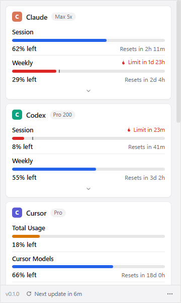

# UsageMaxx — your AI coding limits in the Windows tray

UsageMaxx sits in the Windows notification area and shows how much of your AI coding
subscriptions you've used: Claude, Codex, Cursor, GitHub Copilot, and more. Click the icon for a
dashboard of meters, reset countdowns, and pace warnings; pin up to two meters to draw them right
on the tray icon.

> **Unofficial.** UsageMaxx is an independent Windows port of
> [OpenUsage](https://github.com/robinebers/openusage) by Robin Ebers, a macOS menu-bar app (MIT).
> It is not affiliated with or endorsed by OpenUsage or any of the providers it reads.



*The packaged app on a Windows CI runner, with demo data.*

## Features

- **A tray icon that reads at a glance.** Up to two pinned meters drawn as bars, colored by pace,
  sharp at 100%, 150%, and 200% scaling. The tooltip lists every pinned reading.
- **A popup dashboard.** One card per provider with its plan, progress meters ("52% left" or "48%
  used"), reset countdowns or exact times, pace warnings ("Limit in 1d 23h"), and an "Outdated"
  tag when data is old. Less important rows sit behind each card's caret with quick links.
- **Ten providers**, using the logins their own apps and CLIs already stored (see below).
- **Refreshes every 5 minutes**, plus on demand (F5 or the footer). A failed refresh keeps the last
  good numbers and shows why; missing values read "No data", never a made-up zero.
- **Finds your tools on first run.** A welcome screen lists the providers signed in on this PC,
  checked locally without contacting anyone.
- **Settings in the popup:** turn providers and individual metrics on or off, choose what's pinned
  to the tray, save API keys (encrypted), launch at login, Read-only Logins, used/left,
  countdown/exact time, 12/24-hour time, and light/dark theme.

## Status

Version 0.1: unofficial, unsigned, and new.

- **Checked by hand** on Windows 11 on ARM (Parallels on an Apple Silicon Mac) with live Claude and
  Codex accounts: installing, the tray icon and popup, first run, and live usage numbers.
- **Checked automatically on every build:** the installer is run on both an x64 and an ARM Windows
  machine in CI, and the installed app is launched; unit tests cover every provider against recorded
  API responses.
- **Not yet checked by hand:** the other eight providers with live accounts, saving API keys, Read-only
  Logins, and uninstalling. If you use any of them, reports are welcome in
  [Issues](https://github.com/memoliertorerr/UsageMaxx/issues).

## Installation guide

UsageMaxx runs on Windows 10 and 11, on Intel/AMD PCs and on Windows on ARM (Snapdragon laptops,
or Windows 11 in Parallels on an Apple Silicon Mac). One installer covers both and installs the
native build for your PC.

### 1. Sign in to your AI tools first

UsageMaxx shows usage from the logins your tools already saved on this PC; it never asks for a
password. Sign in **before** the first launch, so the welcome screen finds them. You only need the
tools you actually use:

| Tool | How to sign in on Windows |
|---|---|
| Claude Code | In PowerShell: `irm https://claude.ai/install.ps1 \| iex`, then open a new window, run `claude`, and sign in in the browser |
| Codex | `winget install OpenAI.Codex`, then `codex login` and sign in with your ChatGPT account |
| Cursor | Open Cursor and sign in |
| GitHub Copilot | Sign in to Copilot in your editor, or `winget install GitHub.cli` then `gh auth login` |
| Devin, Grok, OpenCode Go | Sign in with their CLIs: `devin auth login`, `grok login`, or log into OpenCode Go in OpenCode |
| Ollama Cloud | Install Ollama, run `ollama signin`, then turn Ollama on in Settings → Providers (it never turns itself on) |
| OpenRouter, Z.ai | Nothing to install: add your API key later in Settings → API Keys |

If a tool's own installer says its folder isn't on your PATH (Claude Code: `claude` "is not
recognized"), run it by its full path once to sign in:

```powershell
& "$env:USERPROFILE\.local\bin\claude.exe"
```

If `winget` fails with "The file cannot be accessed by the system", Windows hasn't finished setting
it up for your account yet. Register it, then open a new PowerShell window:

```powershell
Add-AppxPackage -RegisterByFamilyName -MainPackage Microsoft.DesktopAppInstaller_8wekyb3d8bbwe
```

### 2. Download the installer

There are no releases yet; every push builds the installer in CI.

1. Open this repository's **Actions** tab, choose the **CI** workflow, and open the latest
   successful run on `main`.
2. Under **Artifacts**, download **usagemaxx-installer** (about 300 MB; GitHub asks you to sign
   in, and artifacts expire after 90 days).
3. Unzip it to get `UsageMaxx-Setup-0.1.0.exe`. Put it in a folder on your PC's own disk, such as
   `C:\Install`.

With the GitHub CLI, the same download is one command (`<run-id>` is the run's number in its URL):

```powershell
gh run download <run-id> --repo memoliertorerr/UsageMaxx --name usagemaxx-installer
```

### 3. Run the installer

1. Double-click `UsageMaxx-Setup-0.1.0.exe`. It isn't code-signed yet, so Windows SmartScreen
   shows "Windows protected your PC": choose **More info → Run anyway**.
2. If **Smart App Control** blocks it instead, with no "Run anyway", Windows only allows signed
   apps on this PC. Turning Smart App Control off is a Windows security setting (Windows Security →
   App & browser control), so it's your call.
3. The installer is per-user (no admin rights), lets you choose the folder (default
   `%LOCALAPPDATA%\Programs\UsageMaxx`), adds a Start-menu shortcut, and starts UsageMaxx when it
   finishes.

### 4. First launch

1. A welcome screen lists the tools signed in on this PC, already ticked. Choose **Continue**.
   (**Choose Later** starts with nothing on; add providers in Settings → Providers.)
2. **Show the icon on the taskbar.** Windows 11 hides new tray icons in the overflow (**^**) menu.
   Drag the UsageMaxx icon from there onto the taskbar, or turn it on in **Settings →
   Personalization → Taskbar → Other system tray icons**. (Windows 10: **Settings →
   Personalization → Taskbar → Select which icons appear on the taskbar**.)
3. Left-click the icon for the dashboard; right-click for Refresh Now, Settings, and Quit.
   **Launch at Login** is in Settings → General.

**On Windows on ARM**, you can confirm it runs natively: in Task Manager → **Details**, right-click
a column header → **Select columns** → **Architecture**. UsageMaxx shows **ARM64**.

**In Parallels on a Mac**, use Window or Full Screen mode, not Coherence: in Coherence, Parallels
moves Windows' tray icons into the Mac menu bar. Run the installer from a folder on the Windows
disk, not a shared Mac folder (`\\Mac\...`).

### Updating and uninstalling

- **Update** by running a newer installer over the old one. Your settings, saved API keys, and cache
  in `%APPDATA%\UsageMaxx` are kept. (There's no auto-update.)
- **Uninstall** from **Settings → Apps → Installed apps → UsageMaxx**. The data folder
  `%APPDATA%\UsageMaxx` stays until you delete it.

### If something's off

- **A card says "Not logged in"**: sign in with that tool (step 1), then press F5 in the popup.
- **No icon after installing**: look in the overflow (**^**) menu, or start UsageMaxx from the
  Start menu.
- **"Missing Shortcut" right after installing, and no `UsageMaxx.exe` in the install folder**: an
  early ARM build had this bug (fixed on 2026-10-16). Uninstall, then install a current build.
- Each provider's page under [docs/providers](docs/README.md) has its own troubleshooting.

## Supported providers

| Provider | What it shows | Where the login comes from on Windows |
|---|---|---|
| [Claude](docs/providers/claude-usage.md) | Session, Weekly, Fable, Sonnet (off by default), Extra Usage | Claude Code: `%USERPROFILE%\.claude\.credentials.json` (or `CLAUDE_CONFIG_DIR`); `CLAUDE_CODE_OAUTH_TOKEN` as a limited fallback |
| [Codex](docs/providers/codex.md) | Session, Weekly, Spark, Extra Usage, Rate Limit Resets | Codex CLI: `%USERPROFILE%\.codex\auth.json` (or `CODEX_HOME`) |
| [Cursor](docs/providers/cursor.md) | Total Usage, Cursor Models, Other Models, Grok Bot, Extra Usage | Cursor's `%APPDATA%\Cursor\User\globalStorage\state.vscdb`, opened read-only |
| [Copilot](docs/providers/copilot.md) | Credits, Extra Usage, org credits and spend, Chat, Completions | Copilot editor plugins, the GitHub CLI (`hosts.yml` or `gh auth token`), or Windows Credential Manager |
| [Devin](docs/providers/devin.md) | Daily, Weekly, Extra Balance | Devin CLI: `%APPDATA%\devin\credentials.toml`; the Devin app |
| [Grok](docs/providers/grok.md) | Weekly, Extra Usage | Grok CLI: `%USERPROFILE%\.grok\auth.json` |
| [Ollama Cloud](docs/providers/ollama.md) | Session, Weekly, or Monthly; Purchased Credits | Ollama's signing key `%USERPROFILE%\.ollama\id_ed25519`. Turn it on yourself |
| [OpenCode Go](docs/providers/opencode.md) | Session, Weekly, Monthly | `%USERPROFILE%\.local\share\opencode\auth.json` |
| [OpenRouter](docs/providers/openrouter.md) | Credits, Balance, Today, This Week, This Month, Key Limit | An API key in Settings → API Keys, or `OPENROUTER_API_KEY` |
| [Z.ai](docs/providers/zai.md) | Session, Weekly, Web Searches | An API key in Settings → API Keys, or `ZAI_API_KEY` / `GLM_API_KEY` |

Each provider's page explains its credential sources, endpoints, troubleshooting, and what wasn't
ported from OpenUsage. Local spend tiles (Today / Yesterday / Last 30 Days from CLI logs) aren't
built yet.

## Privacy

- **Your logins stay on your PC.** UsageMaxx reads them where your tools stored them and sends
  each token only to that provider's own servers.
- **No telemetry, analytics, or update checks.** The only network requests are the providers'
  usage APIs (and their token endpoints, when a login is renewed).
- **API keys are encrypted** with Windows DPAPI (Electron `safeStorage`) in
  `%APPDATA%\UsageMaxx\api-keys.json`, readable only by your Windows account. If encryption isn't
  available, the key isn't saved at all.
- **It writes very little.** Settings, a cache of the last numbers, and a log go to
  `%APPDATA%\UsageMaxx`; the log never contains tokens or keys. Other apps' files are only written
  when a Claude, Codex, or Grok login is renewed, and then only the token fields change. Cursor's
  database is never written. With **Read-only Logins** on, nothing is renewed or written.

## Risks and terms

UsageMaxx is unofficial and not affiliated with OpenUsage or with any provider it reads.

- **How it reads usage.** Claude, Codex, Cursor, Copilot, Z.ai, Grok, and Devin are read through
  undocumented, internal endpoints, using the login that provider's own CLI or app stored.
  UsageMaxx identifies itself the way those clients do and, unless **Read-only Logins** is on,
  renews expired logins with their client IDs. OpenRouter, Ollama Cloud, and OpenCode Go are read
  through documented APIs.
- **Provider terms may restrict this.**
  - In February 2026, Anthropic's Claude Code legal page said subscription OAuth tokens are only
    for Claude Code and claude.ai
    ([The Register](https://www.theregister.com/software/2026/02/20/anthropic-clarifies-ban-on-third-party-tool-access-to-claude/5014546)).
  - Cursor's terms forbid reverse engineering, and its staff have said its private endpoints are
    off-limits
    ([Cursor forum](https://forum.cursor.com/t/does-using-oh-my-pi-s-cursor-provider-or-an-openai-compatible-proxy-to-the-same-endpoints-violate-cursor-s-tos/167778)).
  - GitHub's [Acceptable Use Policies](https://docs.github.com/en/site-policy/acceptable-use-policies/github-acceptable-use-policies)
    apply to how its services are used.
  - No provider has approved this app, and any of these endpoints can change or be blocked at any
    time.
- **What limits the risk.** UsageMaxx only reads usage; it never sends AI requests on your
  subscription. It refreshes each provider about once every 5 minutes (a few small requests each),
  backs off when rate-limited (Claude waits out Anthropic's `Retry-After`; the others wait for the
  next 5-minute refresh), sends tokens only to the provider's own servers, and never writes
  Cursor's database. **Read-only Logins** (Settings → General) removes token renewal
  entirely: when a login expires, its card asks you to sign in again with the provider's own app or
  CLI.

Use it at your own risk. This section isn't legal advice.

## Building from source

You need Node 24 (22 or later works) and npm. On Windows:

```powershell
npm ci
npm run dev        # run the tray app; set USAGEMAXX_DEMO=1 for demo data
npm run verify     # typecheck + unit tests
npm run dist:win   # build the installer into dist\
```

On macOS or Linux, the app runs for development (the tray icon appears in the menu bar), and
`source scripts/env.sh` first keeps every cache inside the repository. The installer is built on
Windows (CI does this). See [docs/README.md](docs/README.md) for the architecture, settings, and
provider docs.

## Relationship to OpenUsage

UsageMaxx is an unofficial port. OpenUsage (MIT) is a native Swift app for macOS; UsageMaxx
reimplements its provider behavior (credential locations, endpoints, headers, field names, and edge
cases) in TypeScript on Electron for Windows. The original's copyright and license are reproduced
in [NOTICE](NOTICE).

"OpenUsage" and its logo are trademarks of Robin Ebers, so this project uses its own name and icon
([upstream TRADEMARK.md](https://github.com/robinebers/openusage/blob/main/TRADEMARK.md)). OpenUsage
doesn't support Windows, and this port isn't offered upstream; [docs/upstream.md](docs/upstream.md)
explains why. Other community ports exist too: [Pane](https://github.com/ItsJazii/pane) (Tauri and
Rust) and [CrossUsage](https://github.com/barramee27/crossusage) (Linux and Windows).

## License

[MIT](LICENSE) © 2026 Mehmet Ali Ertorer. Upstream credit and the trademark note are in
[NOTICE](NOTICE).
